# 趣谈网络协议

## 第1讲-为什么要学习网络协议？

协议三要素：

- 语法：内容要符合一定的规则和格式
- 语义：内容要代表某种意义
- 顺序：先做什么，后做什么

常见的网络协议：

- 应用层

  - 地址簿协议
    - 一般DNS
    - 更加精准HTTPDNS

  - 浏览请求
    - 普通HTTP
    - 加密传输HTTPS

- 传输层

  - 无连接UDP
  - 面向连接TCP
    - 面向连接，TCP会保证这个包能够到达目的地。如果不能到达，就会重新发送，直至到达为止。
    - 内容里，会包含2个端口，分别是：浏览器监听的端口，目的地服务器监听的端口。

- 网络层

  - IP层
    - 内容里，会包含2个IP地址，分别是：源IP（我从哪里来），目的地IP（我要去哪里）
    - 如何去目的地IP？
      - 如果是外地人
        - 步骤：
          - IP地址发给网关Gateway，吼一声（ARP协议：Who has？），网关返回目的地的本地地址（MAC地址）
          - 包到达网关Gateway。
          - Gateway将包发送，经过一个个网关，最终到达最后一个网关
          - 最后一个网关，吼一声（Who has 目的地IP？），目的地服务器回复MAC地址
          - 最后一个网关，根据目的地服务器MAC地址，将包发送到目的地服务器
        - 网关Gateway
          - 操作系统启动时，DHCP协议会配置IP地址，及网关的默认IP地址`192.168.1.1`
          - 网关往往是个路由器，到某个IP地址怎么走（这个叫路由表）
          - 常用的路由协议
            - OSPF
            - BGP
  - MAC层

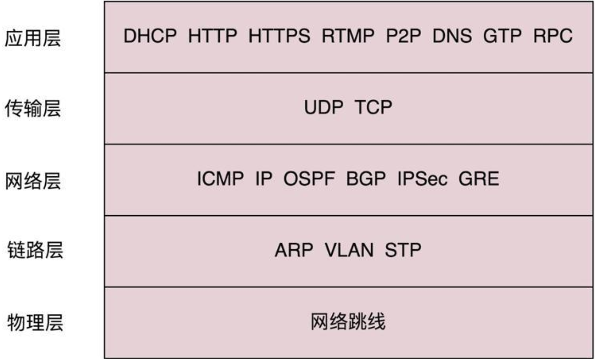

## 第2讲-网络分层的真实含义是什么？

什么是二层设备？

就是将网络包的MAC头取下来，然后决策这个网络包应该丢弃、转发，还是自行处理。

什么是三层设备？

就是将网络包的MAC头取下来，然后将IP头也取下来，然后决策这个网络包应该丢弃、转发，还是自行处理。

完整的网络包，可以有下层没上层，但是绝对不可能有上层没下层。

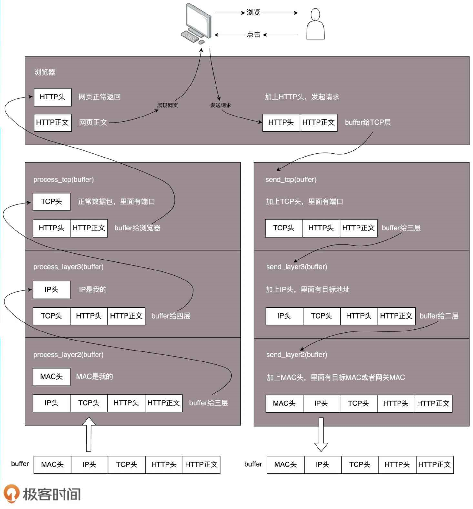

## 第3讲-ifconfig：最熟悉又陌生的命令行

### IPv6

128位

### IPv4

32位，被分为以下5类：

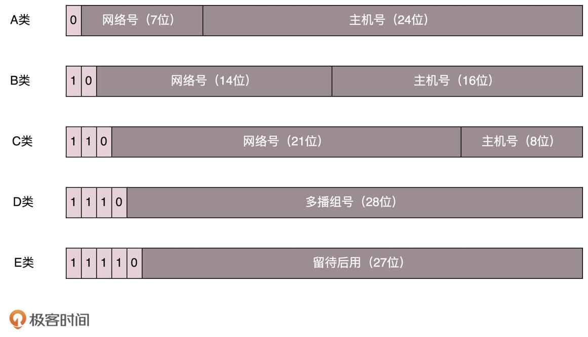

A，B，C类均是由**网络号**+**主机号**组成，它们的范围如下：

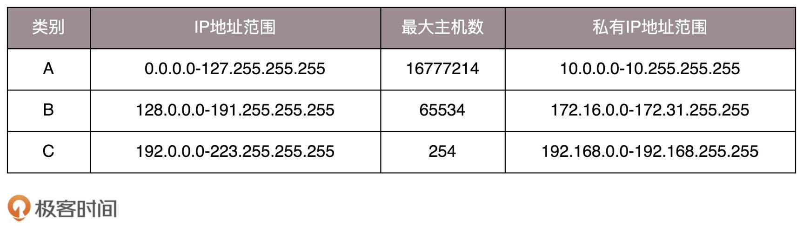

C类的最大主机数太少，而B类的最大主机数又太多。

于是，有了一个折中的方式，那就是：CIDR，无类型域间选路。

#### CIDR（无类型域间选路）

CIDR，Classless Inter-Domain Routing。

无类别域间路由 (CIDR) 是一种 IP 地址分配方法，可提高互联网上的数据路由效率。每台连接到互联网的计算机、服务器和最终用户设备都有一个与之关联的唯一编号，称为 IP 地址。设备通过使用这些 IP 地址相互查找和通信。组织使用 CIDR 在其网络中灵活高效地分配 IP 地址。

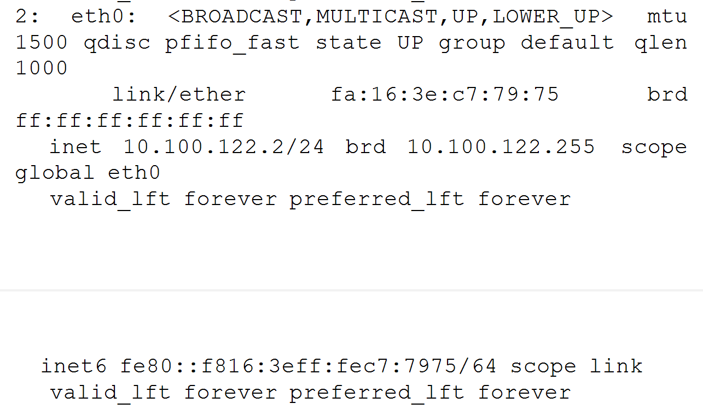

格式如：`10.100.122.2/24`

其中：

- /24，表示32位中前24位是网络号，后8位是主机号；即10.100.122这段是固定的。
- 也就是说IP地址范围为：10.100.122.0 ~ 10.100.122.255

伴随着CIDR存在的：

- 一个是广播地址brd（10.100.122.255），如果网络包发送到这个地址，那么所有10.100.122网络里面的机器都能够收到网络包。
- 另一个是子网掩码（subnet mask）255.255.255.0，IP地址与子网掩码进行按位AND计算后，255代表二进制的`1111 1111`，而1与任何数AND，结果还是1。0代表二进制的`0000 0000`，而0与任何数AND，结果还是0。
- 因此，IP地址`10.100.122.x` 与 子网掩码`255.255.255.0` AND计算后的结果永远都是`10.100.122.0`
- `10.100.122.0`即为网络号。

#### lo网卡

lo，全称loopback，又称环回接口，往往分配到127.0.0.1这个地址，这个网卡只用与本机通信。

#### MAC地址

十六进制，6个byte表示；就像是身份证，是唯一标识。

唯一性设计，是为了组网的时候，不同的网卡在同一个网络里的时候，可以不用担心冲突。

从硬件角度，来保证MAC地址的唯一性。

MAC地址的通信范围很小，局限在一个子网里。例如：

- 10.100.122.1访问10.100.122.244，可以用MAC地址直接通信。
- 10.100.122.1访问10.100.121.1，则无法使用MAC地址直接通信。

#### 网络设备的状态标识

net_device_flags，网络设备的状态标识，格式如：`<BROADCAST,MULTICAST,UP,LOWER_UP>`

- UP，标识网卡处于启动状态
- BROADCAST，标识网卡有广播地址，可以发送广播包
- MULTICAST，标识网卡可以发送多播包
- LOWER_UP，标识L1是启动的，即网线连接

MTU 1500解释说明：

最大传输单元，MTU（Maximum Transmission Unit），指的是网络能够传输的最大数据的网络包的大小，默认值是1500字节。

### 小结

1. IP是地址，具有定位功能，而MAC是身份证，不具备定位功能，但是有唯一性。
2. CIDR，可用来判断是否是本地人。
3. IP分为：公有IP，私有IP

### 课后思考题

1. 你知道 net-tools 和 iproute2 的“ 历史” 故事吗？
2. 这一节讲的是如何查看 IP 地址， 那你知道 IP 地址是怎么来的吗？

## 第4讲-DHCP 与 PXE：IP 是怎么来的， 又是怎么没的？

DHCP，Dynamic Host Configuration Protocol，动态主机配置协议。

DHCP工作方式，以一台机器新加入一个网络为例：

1. 新机器，吼一声，称之为DHCP Discover

2. 新机器，发送一个广播包，包封装了UDP，UDP封装了BOOTP（DHCP是BOOTP的增强版）

3. 这个广播包的内容是：我是新来的，我的MAC地址是XXX，我还没有IP，谁能给我分配一个IP？

4. DHCP Discover格式如：

   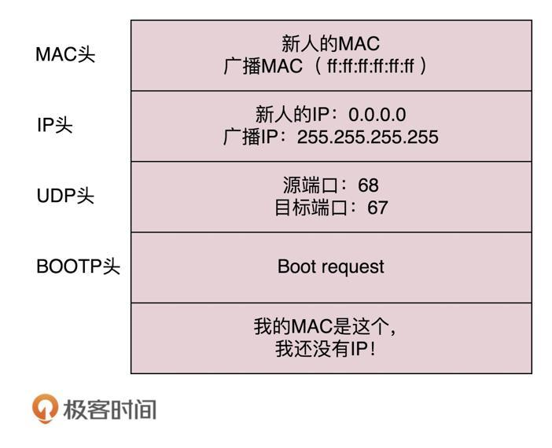

5. 如果网络中配置了DHCP Server的话，DHCP Server就是这些IP的管理员。这时它就知道来了一个新成员，因为这个MAC地址从来没有见过。

6. DHCP Server这时，会将一个IP租给新成员，这个动作叫做DHCP Offer。同时，DHCP Server将会记住分配给新成员的IP地址，不会再将这个IP租给后续新的成员。

7. DHCP Offer格式如：

   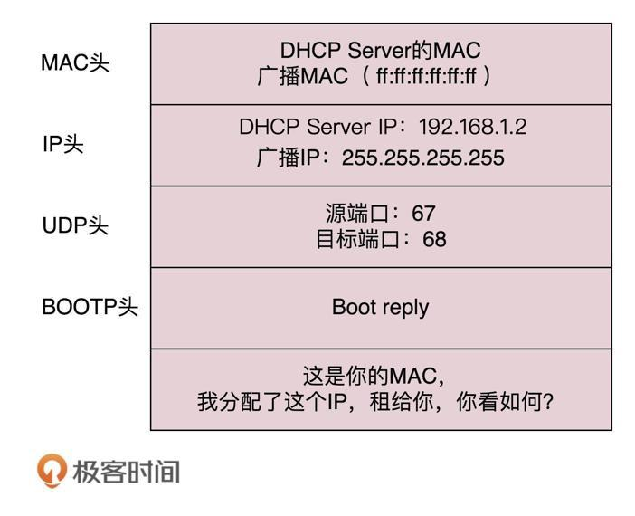

8. DHCP Server将Offer信息、子网掩码、网关以及IP地址租用期等信息，发送到广播地址。

9. 新成员，收到了广播地址发来的广播包，知道了Server提供了一个IP租给它。

10. 如果存在多个DHCP Server，新成员将会收到多个广播包，会有多个IP地址可以租给它。

11. 一般而言，新成员将会使用最先回复的广播包提供的IP地址。

12. 然后，新成员，发送一个DHCP Request广播数据包，包内容包含：

    1. 客户端MAC地址

    2. 接受租约中的IP地址

    3. 提供该租约的DHCP Server地址

    4. 相当于，告诉网络中所有的DHCP Server，它接受了哪一个DHCP Server提供的IP，并告诉其他DHCP Server撤销它们提供的IP地址，以便这些IP地址提供给下一个IP租用请求者。

    5. 由于此时新成员尚未收到DHCP Server的最后确认，因此，新成员依旧以`0.0.0.0`为源IP，`255.255.255.255`为目标地址，发包。包内容如：

       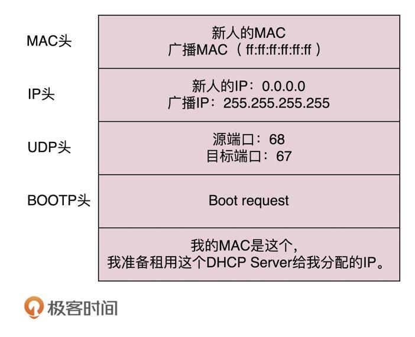

13. 当DHCP Server接收到新成员的包后，会广播返回一个DHCP ACK包，表示：已接收新成员的选择IP，并将这一IP的合法租用信息和其他配置信息放入该广播包中，发给新成员，欢迎它加入。包内容如：

    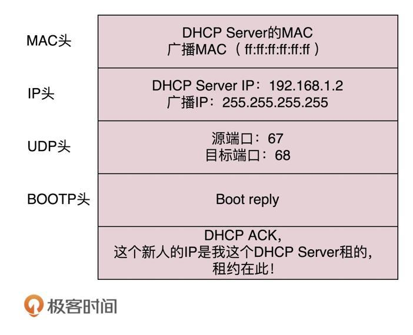

14. 而这个广播包也会通知网络中的其他成员，告诉它们新成员的IP地址是什么。

### IP地址的回收与续租

IP续租流程：

1. 当IP的租期过去50%时，客户端，将会向DHCP Server发送一个DHCP request消息包。
2. DHCP Server收到request消息包后，回复一个ACK包，包内容包含：IP的新租期，其他已经更新的TCP/IP参数。
3. 客户端收到ACK包后，根据包内容，更新自己的配置。

### PXE协议，预启动执行环境，Pre-boot Execution Environment

#### 客户端

PXE客户端，自己也需要有一个IP地址，这个由DHCP Server进行分配。

#### 服务器端

在DHCP Server中：

1. 配置`next-server`，指向PXE服务器IP。
2. 配置初始启动加载文件名称`filename`，指向初始启动文件。

这样一来，PXE客户端启动之后，不但知道分配给自己的IP是多少，也知道PXE服务器的IP是多少，还能知道从PXE服务器上下载的初始启动文件是哪个；完成初始启动文件的下载，从而完成操作系统的初始化启动。

#### PXE完成操作系统初始化启动-流程图
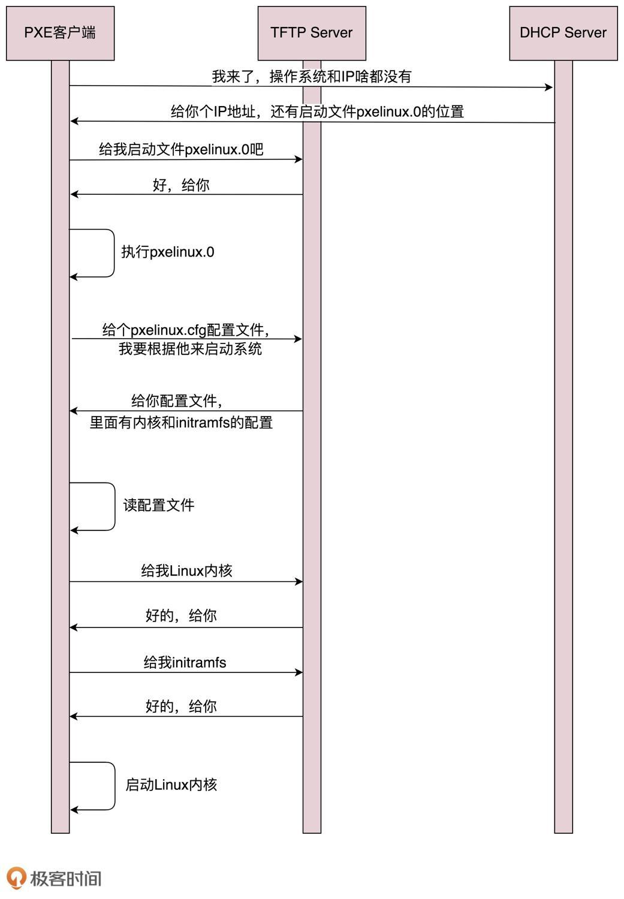

### 小结

DHCP协议的作用：

1. 主要用来给客户提供IP地址。
2. 还能给客户提供***装修队***（PXE协议）
   1. 这个在云计算领域用处更大

### 课后思考

1. PXE协议可以用来安装操作系统，但是如果每次重启都安装操作系统，就会很麻烦。你知道如何使得第一次安装操作系统，后面就正常启动吗？
2. 现在上网很简单了，买个家用路由器，连上WIFI，给DHCP分配一个IP地址，就可以上网了。那你是否用过更原始的方法自己组过简单的网呢？说来听听。

## 第5讲-从物理层到MAC层：如何在宿舍里自己组网玩联机游戏？
- 第一层：物理层

- 第二层：数据链路层，MAC，Medium Access Control，媒体访问控制

  - 控制在往媒体上发数据的时候，谁先发、谁后发的问题，防止混乱。

  - 该问题，术语上说，名为“多路访问”。

  - 例如，以下几种算法，就能解决“多路访问”的问题

    - 信道划分：分多个车道，每个车一个车道，你走你的，我走我的。
    - 轮流协议：今天单号出行，明天双号出行，轮着来。
    - 随机接入协议：不管三七二十一，有事儿先出门，发现特堵，就回去。错过高峰再出。
      - 例如，以太网，就使用随机接入协议。

  - 那么还有个问题：发给谁，谁接收？

    - 物理地址，也叫“链路层地址”，也被叫做MAC地址。

  - 解决第一个问题就牵扯到第二层的网络包格式。对于以太网，第二层的最开始，就是目标的MAC地址和源的MAC地址。

    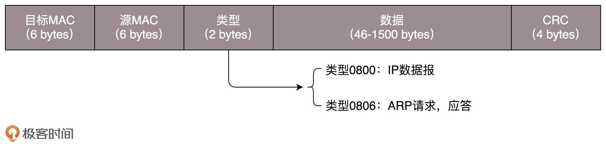

---

存在的问题：

- 这个包是发给谁的？谁应该接收？
  - 解决方式：物理地址，即MAC地址
  
- 大家都在发，会不会产生混乱？有没有谁先发、谁后发的规则？
  - 算法，例如：信道划分，随机接入协议，轮流协议
  
- 如果发送的时候出现了错误，怎么办？
  - CRC，Cyclic redundancy check，循环冗余校验；通过XOR异或的算法，计算整个包在发送过程中是否出现了错误，包内容被修改了。
  
- 当源机器知道目标机器时，可以将目标地址放入包里面，可如果不知道呢？一个广播的网络里接入了N台机器，我怎么知道每个MAC地址是谁的呢？
  - ARP协议，也就是：已知IP，求MAC地址的协议。
  
    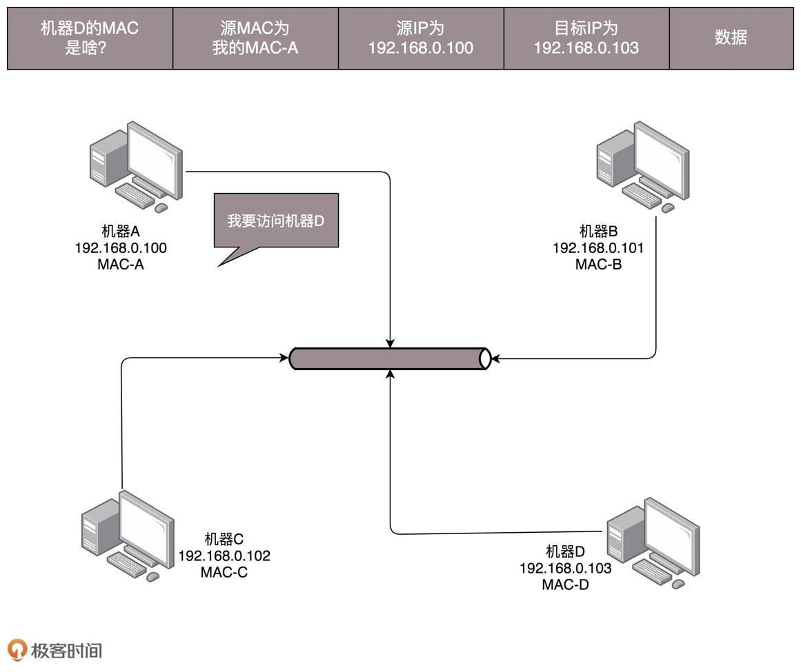
  
- 交换机，有着MAC地址学习能力，学完之后，它就知道根据包的目标MAC地址，准确地转发到对应MAC的设备上。

### 小结

1. MAC层，是用来解决多路访问的堵车问题的。
2. ARP是通过吼的方式，来寻找目标MAC地址的，吼完之后记住一段时间，这个叫作缓存。
3. 交换机，具有MAC地址学习能力，学完它就知道谁在哪了，不用再广播了，而是精准转发。

### 思考题

1. 我们知道ARP协议，是已知IP求MAC地址；而RARP协议，则是已知MAC求IP地址。请问RARP协议，可以用来干什么呢？
2. 如果一个局域网里面，有多个交换机，ARP广播的模式会出现什么问题呢？

## 第6讲-交换机与VLAN：办公室太复杂，我要回学校
- 拓扑结构

### 如何解决常见的环路问题？

- 数据结构中，有一个方法叫做**最小生成树**。有环的，常称之为***图***。当环被破坏后，就成了***树***。
- 生成树的算法，叫做***STP***，全称***Spanning Tree Protocol***。
  - 概念介绍，以武林门派为比喻：
    - Root Bridge，根交换机，好比是门派掌门。
    - Designated Bridges，指定交换机，好比是门派掌门代理人。
    - Bridge Protocol Data Unit，BPDU，网桥协议数据单元；好比是武功切磋，谁功力更胜一筹，谁就胜出，胜出者职位更高。只有掌门能发起（好比是，切磋必须由掌门同意）
    - Priority Vector，优先级向量。可以比喻为实力（值越小越厉害），就是一组ID数目。
      - Root Bridge ID
      - Root Path Cost
      - Bridge ID
      - Port ID

### STP工作过程

- 网络管理员给每一个交换机都分配ID，同时，会根据交换机的配置高低，分配高优先级给配置高的交换机。
- 然后各个交换机开始发BPDU，比拼实力；胜者仍可以发BPDU，而败者，将不能再发，只能转发胜者的BPDU，表示服从。
- 合并情形
  - 掌门遇上掌门：败者将携整个门派投入胜者门下。
  - 同门相遇
  - 掌门与其他门派小弟相遇：掌门与小弟所属门派的掌门比较。如果赢了，小弟投入门下，并逐渐拉拢和自己连接的兄弟，一起投入；如果输了，掌门拜入小弟所属门派。
  - 不同门派的小弟相遇
